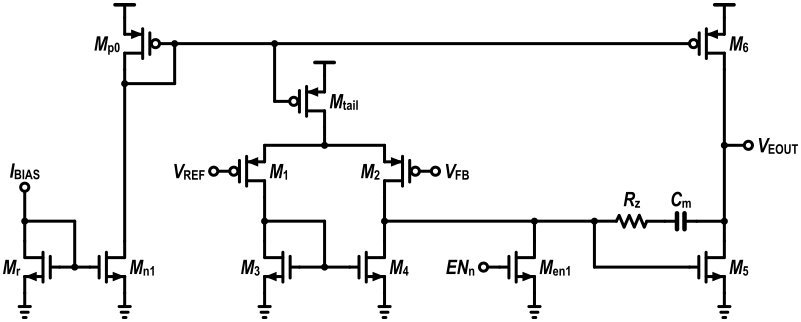
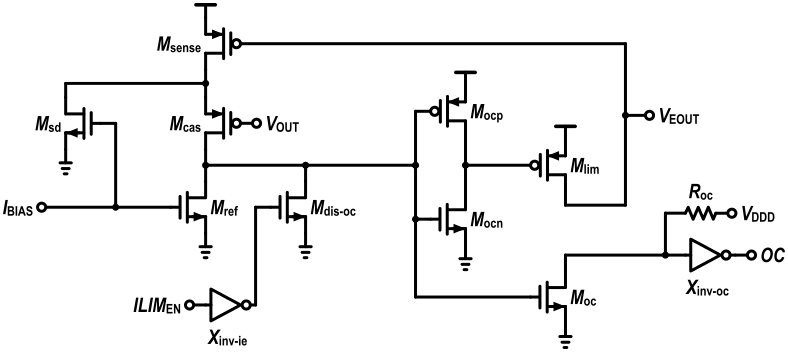

# sg13cmos5l_vyges_ip__ldo_capless

Capacitor-less (**capless**) low-dropout regulator (**LDO**) for the IHP
**SG13CMOS5L** process — **3.3 V in → digitally-trimmable ~1.0–1.8 V out** (default
1.2 V), internally compensated so it needs **no external or large on-chip
capacitor**. **All-CMOS** (PMOS pass device + error amp; no MiM cap — compensation
is MOM/poly), sized to a single openframe analog-slot footprint. Built for the
**Chipalooza Challenge #2 (IHP SG13CMOS5L)**.

## Current status

**Phase: laid out, handed off to the harness, and passing post-layout (compensation retuned 2026-10-19).**

- ✅ **The design is captured and reproducible.** Nine cells generated from a single source,
  netlisted, and simulated from a clean clone by `sim/run.sh`.
- ✅ **Every published specification is met except one** — the load-release overshoot. It no
  longer reaches the supply rail at any corner, which was the reliability concern, but it
  still exceeds its excursion target.
- ✅ **Two specifications were restated to the quantity the physics governs**, and both then
  passed: droop as a load **slew rate** rather than a step size, and supply rejection as a
  **mask over frequency** rather than a single point. Each limit is the worst of 243 corners,
  not a typical value.
- ✅ **Verified across corners, not at one operating point** — 243 PVT corners for phase
  margin and for supply rejection, 81 for the transient response.
- ✅ **Connectivity is checked on the netlist, cell by cell** — all eight cells pass with no
  shorted device terminals, no unterminated nets and no auto-generated net names surviving,
  against the pinned PDK and with every capacitor present.
- ✅ **Laid out as a block of its own, and handed off.** `gds/` holds the block cell
  `sg13cmos5l_vyges_ip__ldo_capless` and `slot_11.gds`, which instances it once inside the
  harness wrapper. DRC 0 and antenna 0 on both; LVS matches apart from the 11 folded resistors,
  each of which is drawn to the straight resistor's exact value (see Physical design). The
  harness test build places it and its contract check passes.
- ✅ **Post-layout, phase margin passes: 48.4° worst against the 45° floor** (schematic 49.4°).
  The first layout failed at 39.4°. The compensation was retuned on the extracted netlist
  itself (input pair 5 → 2.5 µm, `Rz` 35.2 → 40.48 µm, `Cc` 2.06 → 3.56 pF), re-laid out and
  re-extracted: 0 of 243 corners below 45° post-layout. Every other published row passes
  post-layout except the load-release overshoot, which already fails on the schematic. The
  retune cost about 2.6 dB of PSRR and a third of the droop slew rate; both still pass, with
  less margin. See Physical design.
- ⛔ **Known limits to read before integrating**: the supply-rejection mask **stops** — above
  roughly 36 kHz at the worst corner this block does not reject supply ripple and near 2 MHz
  it amplifies it, so it should not be fed directly from a switching regulator; and the
  control logic runs from the 1.2 V rail, so the block cannot bring itself up in a system
  where it is the source of that rail.

Detail: [`doc/implementation.md`](doc/implementation.md) for what is built and measured,
[`doc/datasheet/`](doc/datasheet/) for the generated datasheet and figures, and
[`doc/proposal.md`](doc/proposal.md) for the original design intent.


The top level: the error amplifier drives the gate of the 64-finger PMOS pass device; `Cc`
compensates; `Rtop` over the trimmed ladder feeds `vfb` back; `Msense`/`Mcas` mirror the pass
current into the current limit, which pulls the gate up through `Mlim`. The figures in
[`doc/figures/`](doc/figures/) are drawn from the xschem schematics and checked against them pin
by pin (the check tables are in that directory's README); the schematics in `xschem/` remain
the source of truth.

| Error amplifier | Current limit and `oc` sense | Feedback trim network |
| --- | --- | --- |
|  |  |  |

## What it is

A clean, reusable local-supply regulator for sensitive analog/mixed-signal
blocks. Designed to drop into one openframe pallet slot: 3.3 V VIN from
the slot power switch, reference/bias from the harness V/I references, and
5-bit output trim over the digital control-status bus. It asks for **one dedicated
low-resistance pad** for `vout` and no other sole-use analog access.

⚠️ The proposal also asked for a muxable Kelvin `vout_sense` pin, on which mux resistance
would not matter because a meter sinks no current. **That pin is not in this revision** —
the block brings out a single `vout`. Adding it is a wire, not a circuit, but it needs a
pad to be worth adding.

Measured on the schematic hierarchy, tt/27 °C unless noted:

| Parameter | Measured | Specification | |
| --- | --- | --- | --- |
| Input | 3.0 – 3.6 V | 3.3 V nominal | |
| Output, trimmed | 0.9999 – 1.7977 V, 32 monotonic codes | 1.0 – 1.8 V | ✅ |
| Load | 0 – 50 mA | up to 50 mA | ✅ |
| Line regulation | 0.51 mV/V | 5 mV/V max | ✅ |
| Load regulation, 0→48 mA | 0.35 mV | 20 mV max | ✅ |
| Dropout at 50 mA | 150.0 mV | 250 mV max | ✅ |
| Quiescent current, enabled | 41.5 µA | 60 µA max | ✅ |
| Standby current, disabled | 3.19 µA | — | |
| Current limit trip | 58.5 mA | 60 mA | ✅ |
| Phase margin, worst over load | 63.3° (no load) | 45° min | ✅ |
| Phase margin, worst over PVT | 49.4° (ff / best-case sheet / 110 °C / 3.0 V / no load), 0 of 243 corners below; **48.4° post-layout** | 45° min | ✅ |
| PSRR at 100 Hz | 52.2 dB | 50 dB min | ✅ |
| **PSRR at 1 kHz** | **32.4 dB** | 30 dB min | ✅ |
| PSRR at 10 kHz | 12.5 dB | 10 dB min | ✅ |
| Supply rejection holds below | **49.4 kHz** (36.4 kHz worst corner) | — | |
| Load slew rate for ≤120 mV droop | **1.77 mA/µs** | 1 mA/µs min | ✅ |
| **Load-step droop at 19 mA/µs** | **404.7 mV** | beyond the specified rate | |
| **Load-release overshoot, 20 → 1 mA** | **228.3 mV** | 120 mV max | ❌ |
| Load step meeting ±120 mV | **2 mA** (droop 65.6 mV, overshoot 73.8 mV) | — | |
| Output capacitor | **capless** — on-chip compensation only | no external cap | ✅ |

⚠️ **One specification is still missed, and two have been restated as the things they
actually depend on.** The release overshoot is bounded at every corner now rather than
reaching the supply rail, but still exceeds 120 mV. **The droop is now specified as a load
SLEW RATE rather than a step size**, and **PSRR as a mask over frequency rather than one
number at 1 kHz** — in both cases because that is what the quantity is a function of.

🔑 **Why the PSRR specification changed shape.** Rejection here is a slope, not a point. The
open-loop supply coupling is a constant 47.4 dB — flat to 1.5 dB from 10 Hz to 10 kHz — and
the loop divides it down, so rejection falls 20 dB per decade. A flat 40 dB limit crosses
that slope once and describes neither side of the crossing. The mask is parallel to the
physics instead: **50 / 30 / 10 dB at 100 Hz / 1 kHz / 10 kHz**, each the worst of 243 PVT
corners rounded down to the next 10 dB. The 2026-10-19 compensation retune spent most of the
margin that left: the worst corners are now 50.96 / 31.09 / 11.10 dB, about 1 dB over the mask
(it was ~3.6 dB). The corner spread is unusually tight — 2.3 to 2.6 dB across process, resistor sheet, temperature, supply
and load.

⛔ **And the mask stops. Above about 36 kHz at the worst corner (49 kHz typical) this block
does not reject the supply at all**, and in the low-MHz range it *amplifies* it — 5.3 dB typical
and 12.4 dB at the worst corner, so output
ripple can be four times the supply ripple that caused it. **Do not feed this block directly
from a switching regulator**: a converter's fundamental lands squarely in that band, and being
capless there is no output capacitor to cover it. Filter the input or accept the ripple. The
frequency where rejection runs out is a reported figure in the datasheet so the mask cannot be
read as extending past where it is true.

🔑 **Why the droop specification changed shape.** It is a ramp-tracking error: the loop
follows the load ramp to about three parts in ten thousand, and that residue is the droop.
Measured by watching the pass current rather than the gate that controls it — at the end of a
1 µs edge the pass device delivers 20.0063 mA against a 20.000 mA load. Two consequences an
integrator needs:

- **It scales with dI/dt, not with step size.** 404.7 mV at 19 mA/µs, 209.8 at 4.75, 125.8 at
  1.90, 82.7 at 0.95 — the same 1 → 20 mA step throughout, only the edge changing. So the
  block holds ±120 mV up to **1.77 mA/µs**, and that is the specification. (2.65 mA/µs before the
  2026-10-19 compensation retune: the narrower input pair has less transconductance to track
  the ramp with.)
- **More output capacitance does not help.** Nearly tripling `Cout` moves the droop by
  0.3 mV, in the wrong direction. A tracking error is not an integration, so the output
  capacitor is not the lever, and 17 % of the slot does not have to be reserved for one.

🔑 **But the step size is ours to specify, so it is now specified.** The 120 mV target came
from this block's own proposal, not from a requirement. Sweeping step size says what the
block actually holds: **both excursions stay inside ±120 mV up to a 1 → 2 mA step**
(droop 65.6 mV, overshoot 73.8 mV). See `doc/datasheet/ldo_capless_step_profile.svg`.

⚠️ **That row was 3 mA before the slew boost landed, and it is honest to say the boost cost
it.** At a 3 mA release the overshoot is 119.7 mV without the boost and 120.4 mV with it —
the old number passed this self-set limit by 0.34 mV and the new one misses it by 0.44 mV.
The cause is structural rather than incidental: the boost only engages once the output is
about 100 mV high, so a step whose natural overshoot is ~120 mV is exactly where it turns on
marginally and helps least. Below that threshold it does nothing, which is the design intent;
far above it, it is the difference between 235 mV and the supply rail.

ℹ️ **The next two paragraphs diagnose the ORIGINAL defect and describe the block without the
boost.** They are kept because the mechanism is what made the fix possible and because an
integrator's load profile still interacts with it — but the figures in them are pre-boost.
The fix and what it achieves are below them.

⛔ **The release overshoot is a threshold in dI/dt, not in step size.** It was recorded as
a cliff somewhere between a 5 mA and a 7 mA release — it tracks the droop to 231 mV at
5 mA and reaches the rail at 7 mA. Sweeping the release EDGE as well as the step says it is
not a property of the step at all. The same 6 mA step runs to the rail released in 1 µs and
settles within 235 mV released in 2 µs; a 13 mA step, double the charge, rails at the same
rate. The threshold is a **release rate of 5.0–5.5 mA/µs**, set by the one device that
pulls the pass gate up — about 5 µA into roughly 50 pF of compensation capacitance plus
6400 µm of pass-device gate, measured as 0.10–0.13 V/µs against a gate sensitivity of
19.5 mV/mA.

🔑 **Which means the specification this block could hold was a RATE, and by that measure it
was better than one step size suggested even before the fix.** A 7 mA release costs 69 mV at 0.6 mA/µs and 141 mV at
1.5 mA/µs — the same release that reaches the rail at 6 mA/µs. Below roughly 5 mA/µs no
step size tested produces an over-voltage. An integrator whose load releases more slowly
than that is not exposed to this defect.

✅ **THE OVER-VOLTAGE IS FIXED. The output no longer reaches the rail at any corner.** The
release overshoot is **228.3 mV** at the typical corner and **422 mV at the worst of 81
transient corners** (ss / best-case sheet / 110 °C / 3.0 V; 235.6 and 573 mV before the
2026-10-19 compensation retune), against an unboosted design that reached the supply rail at **81 of
81**. What the reviewer asked to have fixed — an over-voltage on thin-oxide devices — is
gone. The 120 mV target is still missed, so the row stays ❌, but it is now an ordinary
excursion rather than a reliability hazard.

The block that does it is [`ldo_boost`](xschem/ldo_boost.sch), and its shape follows from
what the pull-up could not be. That device is also the second stage's load, so its current
sits in the loop gain: widening it clears the release and takes the 243-corner phase-margin
minimum from 45.6° to 38.5°, nine corners below specification. So the boost had to be large
during the event and absent from the small-signal loop. It is an over-voltage comparator
against a tap on the reference divider, vetoing a dv/dt path, with both output devices in
series — current reaches the pass gate only when the output is above its regulation point
**and** rising quickly. Neither conducts at the operating point.

⚠️ **What it cost, stated rather than buried.** Quiescent current 35.8 → **41.5 µA** against
a 60 µA budget. Phase margin over PVT 45.6° → **45.1°**, still with no corner below 45 but
with a tenth of a degree of slack where the block had six. The ±120 mV step row above, from
3 mA to 2 mA. Droop and PSRR are unchanged. Anything further added to that node should be
paid for out of the compensation rather than out of what is left.

✅ **Phase margin over PVT passes**, at 49.4° on the schematic and 48.4° post-layout, with no
corner below specification in either. That is the 2026-10-19 retune, described under Physical
design. Before it, the schematic had 45.1°, reached without changing a device: it was
40.2°, and the block was re-pinned to IHP-Open-PDK
`dev@ab1510c`, which carries a `rhigh` corner re-alignment worth **+5.4°** at the binding
corner. The same re-pin renamed the MoM capacitor `cap_mfringe` → `cap_cmomf` and
recalibrated its density from 2.32 to **1.287 fF/µm²**, so the two compensation capacitors
were re-drawn ×1.80 in area to hold the same 48 pF and 20 pF they always specified — the
capacitance is identical, the silicon it takes is not. Both are worked through in
[`doc/implementation.md`](doc/implementation.md).

Enable, power-good and current limit are implemented and exercised; see
[`doc/implementation.md`](doc/implementation.md). The block needs a 1.2 V control-bus
supply (`vddd`) alongside the 3.3 V rail.

## For the integrator

[`doc/implementation.md`](doc/implementation.md) carries two sections written for scoping
this block into a slot:

- **Assumptions** — the process, slot supply and harness resources the design rests on, with two marked as unconfirmed: the 1.2 V control-bus rail, and the bias current value.
- **Slot requirements** — pads, harness resources, control/status bits, clocks and the
  current budget. One dedicated low-resistance pad for `vout`; no clocks; needs a 1.2 V
  digital rail alongside the 3.3 V supply.
- **Against the proposal** — every specification line with what the schematic measures,
  including the three that do not yet meet target.

## Physical design

✅ **The layout is in [`gds/`](gds/).** The block is its own cell,
`sg13cmos5l_vyges_ip__ldo_capless` (527.15 × 269 µm, pins named by its ports), and
`gds/slot_11.gds` instances it once in the harness slot, with a straight stub from each wrapper
pin it uses to the block pin facing it. Both files are checked on the PDK decks:

| Check | Block alone | In `slot_11` |
| --- | --- | --- |
| DRC (KLayout, main rules) | **0** | **0** |
| Antenna | **0** | **0** |
| LVS (KLayout, strict top-level ports) | matches **except the 11 folded resistors' parameters** | same |
| LVS with those resistors' drawn parameters (confirmation) | **matches** | **matches** |
| Folded resistors by value (PDK resistance, folded vs straight) | **all 11 within 0.007 %** | — |
| Unused wrapper pins clear of our metal | — | **0 violations, 38 pins** |
| Density | fails at block level, as expected — chip-level fill is a harness step | |

In the harness's own test build, the slot is found and placed, its outline and every pin land
on the wrapper's (contract check PASS), and the slot as assembled into the chip is identical
to `gds/slot_11.gds` (XOR clean, 36 layers).

- ✅ **Folded resistors, signed off by value.** A resistor drawn as the PDK `rhigh` serpentine
  extracts as a per-segment `l`, a bend count and a leg spacing, so it can never equal a straight
  schematic `l` ([IHP-Open-PDK#746](https://github.com/IHP-GmbH/IHP-Open-PDK/issues/746)), and
  the PDK prices every bend: R ∝ (b+1)·l + (2/κ·w + ps)·b. Drawn at l/(b+1) per segment, the 11
  resistors came out 0.8–3.6 % high. Each segment is now shortened by the bend term, and the
  generator asks the PyCell itself for the resistance of the folded device and of a straight one
  of the schematic's length: all 11 agree within 0.007 % (the 5 nm grid). A check reading the
  LVS database confirms the layout's bends and widths are the recorded ones.
- ✅ **Control pins** (2026-10-18): `en` → `dig_in[8]`, `ilim_en` → `dig_in[10]`, `vtrim0–4` →
  `dig_in[12]`–`[20]` (even bits), `pgood` → `dig_out[0]`, `oc` → `dig_out[2]`. All power up
  safe at 0: disabled, and the lowest trim code (1.000 V). The single `vss` is fine: the harness
  ties the grounds chip-wide.
- ✅ **The 50 mA path is strapped.** Metal2 runs over every pass finger's source and drain, with
  a via every 1 µm. A Metal3 + Metal4 `vout` band sits at the output pin's height, there are two
  Metal3 + Metal4 + TopMetal1 `vin` bands over the array, and a 28 µm TopMetal1 feed comes from
  `vdd_3v3`. `tools/floorplan.py` checks every segment against the process specification's
  current limits (Rev 0.2 §3.5, 105 °C, 11 years) and reports the IR drop: **26 mV on `vin` and
  8 mV on `vout` at 50 mA**, worst-case sheet resistance. That is computed, not simulated; the
  measured 149.7 mV dropout does not include it.
- ⚠️ **The output pin limits the current rating.** The harness pin for `vout` is Metal3 only,
  24.77 µm tall, which the process specification rates at 49.5 mA, just under 50. If it stays,
  the block is rated 45 mA continuous.
- ⚠️ **The straps add coupling.** Extracted: `vin` to the pass gate 176 fF (about 1 % of its
  roughly 16 pF), `vin` to `vout` 1.4 pF, `vout` +0.8 pF. The post-layout simulation decides
  whether any of it matters.
- ✅ **Post-layout gate (2026-10-19): phase margin 48.4° worst, against 45°**, after a
  compensation retune. The first run (2026-10-18, on the block as first handed off) failed at
  39.4°; its result and attribution follow, then the retune. The run is
  chipalooza's `tools/ldo_postlayout_run.sh`. It swaps the extracted cells (magic 8.3.684,
  capacitance only) into this repository's own benches and judges every row of
  `tools/datasheet.py` on both netlists.

  | Row | Schematic | Post-layout |
  | --- | --- | --- |
  | Phase margin over PVT (min / typ / max) | 45.10 / 64.84 / 74.72° | **39.42** / 59.71 / 72.15° |
  | Output voltage, mid code (typ) | 1.209 V | 1.211 V |
  | Dropout at 50 mA | 149.7 mV | 146.6 mV |
  | Quiescent current (typ) | 41.53 µA | 41.51 µA |
  | PSRR 100 Hz / 1 kHz / 10 kHz | 54.87 / 35.07 / 15.12 dB | 54.84 / 35.04 / 15.10 dB |
  | Load-release overshoot (limit 120 mV) | 235.6 mV | 264.0 mV |

  Line and load regulation, trim range, current-limit trip and droop rate are unchanged and
  pass. Where the 5.7° goes at the worst corner (ff, `res_wcs`, −40 °C, 3.6 V, no load), found by
  removing one extracted component at a time:

  | Cause | Cost |
  | --- | --- |
  | Wiring inside the device cells (gate heads, source/drain metal; the 64 pass fingers dominate) | −2.7° |
  | Coupling between nets, plus the MOM combs as extracted (`Cout` 19.09 pF against the model's 20.11) | −1.6° |
  | magic's reading of the folded resistors (+1–3 % length; the PDK's own value is exact) | −0.8° |
  | Remainder | −0.5° |

  The strap coupling is small (under 1°). The schematic had 0.097° of margin, so any real layout
  was going to need design margin; this run measured how much.

  **The retune (2026-10-19).** Every candidate was priced on the extracted netlist itself as well
  as the schematic, over all 243 corners (chipalooza `tools/ldo_comp_run.sh`). Two corners bind
  and pull opposite ways: ff / `res_wcs` / −40 °C, which the layout costs about 5° and which wants
  less input-pair gm and more `Cc`, and ff / `res_bcs` / 110 °C, which the layout barely moves and
  which wants a longer `Rz`. A narrower pair plus more `Cc` gives the cold corner the room for the
  longer `Rz` the hot one needs. More `Cout` and a different preload were priced too, and lose.

  | Change | Before | After |
  | --- | --- | --- |
  | Input pair `M1`/`M2` | 5 µm | **2.5 µm** |
  | Nulling resistor `Rz` | 35.2 µm (50.0 kΩ) | **40.48 µm** (57.5 kΩ) |
  | `Cc`, pass gate to `vout` | 40 × 40 µm, 2.06 pF | **w 69.15 × l 40 µm, 3.56 pF** (grows up its floorplan column) |

  Re-laid out, re-checked (DRC 0, antenna 0, LVS as before, keepouts 0, resistors by value) and
  re-extracted, the gate on the new block:

  | Row | Schematic | Post-layout |
  | --- | --- | --- |
  | Phase margin over PVT (min / typ / max) | 49.44 / 71.43 / 77.96° | **48.38** / 67.83 / 75.96° |
  | Output voltage, mid code (typ) | 1.209 V | 1.212 V |
  | Dropout at 50 mA | 150.0 mV | 146.7 mV |
  | Quiescent current (typ) | 41.53 µA | 41.50 µA |
  | PSRR 100 Hz / 1 kHz / 10 kHz | 52.23 / 32.42 / 12.49 dB | 52.20 / 32.40 / 12.47 dB |
  | Load slew rate for ≤120 mV droop | 1.77 mA/µs | 1.81 mA/µs |
  | Load-release overshoot (limit 120 mV) | 228.3 mV | 267.6 mV |

  The layout now costs 0.3–6.4° (mean 2.9°), and the worst post-layout corner keeps 3.4° over the
  floor. What it cost: about 2.6 dB of PSRR at every mask point (still passing at the worst of
  243 corners, by about 1 dB) and the droop slew rate, 2.65 → 1.77 mA/µs (limit 1).

**What routing needed that the PDK cells do not provide**, now part of the floorplan: a gate
contact on every MOSFET; a well tap per pMOS, shared across the pass array as **one** tap in one
merged N-well; a substrate tie column beside every nMOS (LU.b); and 1 µm Metal4 stubs that bring
each MOM capacitor's minimum-width terminal pins out of a cell that fills Metal1–Metal4.
Reported upstream as [IHP-Open-PDK#1267](https://github.com/IHP-GmbH/IHP-Open-PDK/issues/1267);
newer PDK versions add a guard-ring option that covers the taps and ties.

**The floorplan is data.** `tools/floorplan.py` places every block from footprints that
`tools/area_budget.py` measured by instantiating the PDK's own PyCells, and the run fails if
any block leaves the slot or lands on another — a diagram cannot do that. It reports 75.7 %
of the 537.15 × 273 µm slot occupied, which is a **floor**: it reserves no routing channels, guard
rings or well taps. `doc/datasheet/ldo_capless_floorplan.svg` is drawn from the same data.

Three measured constraints set the shape: `Cm` at 193 × 193.5 µm and `Cout` at 125 × 125.5
cannot stack (319 µm against a 273 µm slot), so they sit side by side and fix 318 µm of the
537 µm width; the pass array is short enough to sit under something; and long resistors cost
roughly **double** their drawn area once folded, so `XRb` at 1.4 × 2941 µm is pitch-limited
rather than area-limited.

**The pass array is generated and DRC-clean.** `tools/layout_pass.py` emits the 64-device
array as GDS from the `pmosHV` PyCell and `tools/passdrc.sh` runs the IHP deck over a pitch
sweep, which replaced an assumption with a measurement: the devices *do* abut legally, at
2.42 µm, so the array is 154.9 × 101.2 µm. With the gate contacts and the one shared well tap that
routing adds, the floorplan reserves 157.5 × 101.5 µm for it.

🔑 **The pitch is a cliff, not a spacing.** Abutted is clean because adjacent nwells merge;
any gap from 0.02 to 0.5 µm reports `NW.b` (nwell minimum space, 0.62 µm); 0.62 µm is clean
again. **There is no legal pitch between touching and 0.62 µm apart** — across 64 devices
that is 40 µm of width, so nudging one device to slip a strap through costs the whole array.

⛔ The sweep **exits non-zero if no row fails**. A pitch sweep in this project once returned
zero violations at every pitch because the deck arguments were guessed and it never read the
layout, and overlap turned out to be the wrong falsification: coincident geometry *merges*
into shapes that pass every width and spacing rule, so overlapping two transistors is an LVS
error rather than a DRC one. The falsifying case has to stay separate and too close.

```sh
sh tools/passdrc.sh 0.02 0.1 0.3 0.5 0.62 1.0 0     # inside the PDK container
```

⚠️ **A 52 % area saving on the pass array exists and is not taken.** `w` is the *total*
device width and `ng` folds it into fingers, so every `ng` is the same transistor — same W,
same L, same drive — in a different shape, and the drawn area is not flat across that
choice: 245.0, 169.1, 132.8, 117.9, **117.0**, 129.6, 162.0 µm² per device for `ng` 1 to 64.
The block is drawn at `ng=1`, the worst of them. At `ng=16` the 64 devices abut into
124.96 × 59.92 µm and pass DRC — 7488 µm² against 15544.

⛔ **It cost 0.33° of phase margin when the block had 0.097°.** (Measured before the
2026-10-19 retune, which left 3.4° post-layout; the trade is open again but has not been
re-priced.) Folding shares source/drain
diffusions, cutting drain capacitance and lifting the loop's unity-gain frequency from 1.231
to 1.246 MHz: 45.097° → 44.772° at the worst of 243 corners. Nearly all of it is the *first*
fold (`ng` 2 through 16 are flat within 0.03°), so there is no partial retreat. Buying the
margin back with `Cm` works electrically but breaks the floorplan and costs 1.3 dB of PSRR;
buying it with `Cout` helps the failing corner and simply moves the worst case elsewhere.
⟹ The saving is real, and available only if the 45° floor is revisited.

### Layout refinement (branch `layout-refine`, in progress)

Everything above describes the taped-out layout (tag `tapeout-2026-10`). This branch carries
the items from the layout review. Its numbers come from short checks only; the full post-layout
gate runs once the refinements are done.

- **Supply grid.** vss and vin run as TopMetal1 bands over the reference, amplifier, ladder,
  boost and status blocks, fed from a spine on each side. Each band has a 1.64 µm Metal4 finger
  on its centre line, for the drops and the TopVia1 row. The grid stays off the MOM capacitors
  and the vref divider. Each supply terminal is joined to its band by a drawn via stack.
- **Digital row.** All the standard cells (the `en` and `ilim_en` input inverters, and the
  `pgood` and `oc` output drivers) sit in one ringed row beside the left-edge digital pins.
  Before, they were spread over three places 200–330 µm from those pins. `pgood`, `oc` and `en`
  wires went from about 430 µm to about 20 µm.
- **`vdd_1v2` routed 1 µm wide** through a non-default rule, instead of at minimum width: an
  upper bound of about 45 Ω of series resistance, against about 374 Ω before.
- **Guard rings.** Every analog region and the digital row have a p+ substrate ring.

Short check: DRC 0, antenna 0, keepouts 0, as-folded LVS match (block and slot), resistors by
value 0 failures. vout 1.2117 V post-layout (tt / 27 °C, no load). Phase margin at the nine
worst corners of the taped-out layout, three loads each: worst **47.2°** (ff / `res_wcs` /
−40 °C / 3.6 V, no load), against 48.4° for the taped-out layout. The floor is 45°.

The feedback node `vfb` sets most of that margin. It is the divider's high-impedance tap, and at
the worst corner each fF on it costs about 0.065°. The guard rings fence off Metal1, so the
router carries `vfb` on Metal2 and Metal3, under the grid. Its extracted C went:

| Layout | `vfb` C (to vss) | Worst phase margin |
| --- | --- | --- |
| Taped out | 26.9 fF (14.5) | 48.4° |
| Grid with full-width (4 µm) Metal4 | 64 fF | 45.3° |
| Metal4 narrowed to 1.64 µm fingers | 41.6 fF (30.9) | 46.6° |
| + `vfb` routed under a 1.2 µm spacing rule | 31.6 fF (24.4) | 46.8° |
| + the two lowest vss rows stop at the spine | 27.8 fF (20.2) | 47.0° |
| + pgood moved directly above the feedback ladder | 24.8 fF (19.3) | 47.2° |

The spacing rule exists because the router ran vss beside `vfb` at 0.42 µm. The two rows ran
directly over `vfb`'s Metal3 along the bottom of the amplifier band; without the spacing rule,
removing them made things worse (46.25°), because the router filled the gap with vss wires
next to `vfb`. Past that, `vfb`'s C to vss follows its length -- about 0.04 fF/µm on any of
Metal1-3 (holding it off Metal1 moved nothing) -- so pgood, whose comparator takes `vfb`, now sits
on top of the ladder: `vfb` went from about 490 to 386 µm. Deleting couplings from the extraction before the pgood move, at the worst corner: `vfb` to vss
(20.2 fF) is worth 1.3°, and the Miller nodes `nzc` and `eout` to vss (about 150 fF each,
around Cm) 0.8° together; both at once, 2.1° (49.1°). Neither is all removable -- the taped-out
layout had 14.5 fF from `vfb` to vss as well.

## Repository layout

| Dir | Contents |
| --- | --- |
| `xschem/` | schematics — nine cells, generated, `ldo_capless` on top |
| `doc/schematics/` | rendered SVGs of every cell, readable without opening xschem |
| `tools/` | floorplan, area budget, datasheet/drift gate, layout and DRC scripts |
| `sim/` | testbenches — six published, plus the diagnostics that found the mechanisms |
| `netlist/` | extracted / simulation netlists |
| `doc/` | design notes, characterization, datasheet |
| `prototype/ldo/` | feasibility netlist (`ldo.spice`) — stable capless loop demonstrated in-process |
| `gds/` | the layout: block cell `sg13cmos5l_vyges_ip__ldo_capless` and the harness hand-off `slot_11.gds` |
| `verilog/` | digital enable / trim / power-good wrapper (LibreLane) |
| `doc/figures/` | presentation circuit figures (cirfig_gen), each checked pin by pin against the schematic |

## Toolchain

IHP open flow: **xschem / ngspice / magic / netgen / klayout** + **LibreLane**
for the digital wrapper. ngspice must support **OSDI v0.4** (the IHP PSP103
models — SG13CMOS5L shares them with SG13G2) — use IIC-OSIC-TOOLS or
ngspice ≥ 43.

[**Vyges Loom**](https://vyges.com/products/loom) provides independent sign-off
alongside it — `vyges loom meas` measures the loop phase margin, `vyges loom lvs`
gates connectivity against a known-good netlist, and `vyges loom extract` supplies
parasitics once there is layout. Each exits non-zero on a violation, so they run as
build gates. Install: <https://docs.vyges.com/installation.html>. Commands and
results are in [`doc/implementation.md`](doc/implementation.md).

## Reproducing the results

`sim/run.sh` netlists the schematic hierarchy and runs every testbench from a clean
clone. It needs xschem, ngspice, and the IHP PDK — **one checkout now covers both halves**,
since upstream merged the `ihp-sg13cmos5l` overlay into IHP-Open-PDK:

```sh
git clone --branch dev --recurse-submodules https://github.com/IHP-GmbH/IHP-Open-PDK.git
git -C IHP-Open-PDK checkout ab1510cbdcbd61fe82e24ec28179c02ea7083299
PDK_ROOT=$PWD/IHP-Open-PDK python3 IHP-Open-PDK/ihp-sg13g2/libs.tech/ngspice/install.py
PDK_ROOT=$PWD/IHP-Open-PDK PDK=ihp-sg13cmos5l sh sim/run.sh
```

`--recurse-submodules` is not optional, and `install.py` compiles the Verilog-A models
(`psp103`, `psp103_nqs`, `r3_cmc`, `mosvar`) that ship as sources rather than binaries.

⚠️ **One upstream gap to work around.** Both `.spiceinit` files load all six OSDI models
from `$PDK_ROOT/$PDK/libs.tech/ngspice/osdi/`, but `install.py` writes its four only into
`ihp-sg13g2`, while `ihp-sg13cmos5l` ships only the other two (`cap_cmomf`, `cap_cmomi`)
prebuilt. Neither directory holds all six, so whichever `$PDK` you select the elaboration
fails on the missing pair. Symlink the two sets into each other after installing.

`$PDK_ROOT` defaults to `/foss/pdks` (what IIC-OSIC-TOOLS sets) and `$PDK` to
`ihp-sg13g2`, so the bundled PDK still works — but it is the *old* two-repository pin and
will not reproduce the numbers above.

⛔ **A PDK missing `cap_cmomf` does not fail — it silently drops every capacitor.** For a
symbol it cannot resolve, xschem writes `*  Cout -  cap_cmomf  IS MISSING !!!!` as a
*comment*: the netlist stays syntactically valid, simulates, and is missing parts. The
IIC-OSIC-TOOLS bundled PDK still ships the pre-rename `cap_mfringe` and no `cap_cmomf` at
all, and netlisting `ldo_capless` against it loses **five** capacitors, `Cout` and the
compensation among them. ⟹ Grep a fresh netlist for `IS MISSING` before trusting anything
derived from it.

Apache-2.0. See [`NOTICE`](NOTICE) for attribution.
